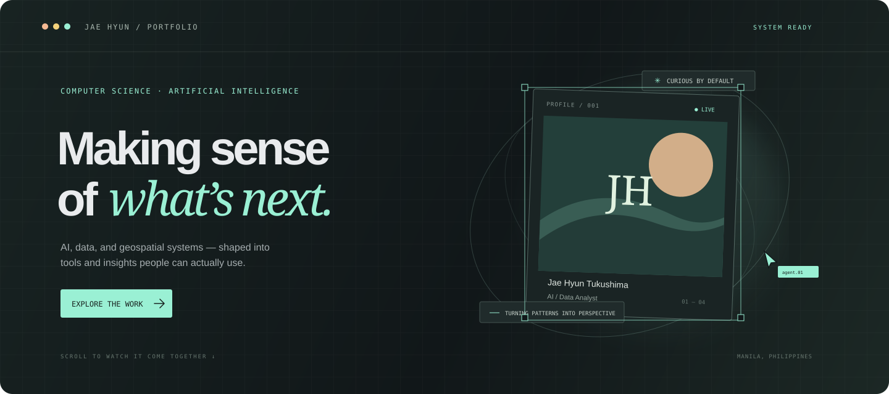

# Jae Hyun Tukushima · Portfolio

### A scroll-driven interface, assembled one scene at a time.

  
  
  
  

---

## One page, composed as a journey

The portfolio unfolds through a connected sequence of scenes: an opening frame, selected work, a personal profile, a timeline, milestones, and a closing contact scene. A compact navigation keeps the full journey within reach while the page remains one continuous scroll.

## The scroll is the timeline

Each animated scene holds in place while its sequence unfolds. Simulated agents select real page elements, size their frames to fit, and reveal each piece where it belongs. The scroll position controls the pacing, so visitors can move through the build at their own speed.

Finished scenes stay assembled when visitors scroll back. On touch devices or with reduced motion enabled, the page opens in its completed layout.

## A system behind the scenes

| Element | What it brings to the experience |
| --- | --- |
| **Scene framework** | Consistent layouts, progress markers, and selection overlays across the page. |
| **Scroll choreography** | Pinned, reversible sequences that follow the visitor’s scroll position. |
| **Measured selection** | Frames that track the size and position of real page elements. |
| **Project details** | Inline expansions that keep visitors in the flow of the page. |
| **Navigation** | Section links that track the active scene and respond to scroll direction. |
| **Responsive motion** | A complete touch layout, reduced-motion support, and desktop-only pointer effects. |

## Designed as a complete interface

The visual system pairs navy, cream, and selective coral accents with light and dark themes. Navigation, project disclosures, buttons, cursor effects, and the background grid each respond to input without competing with the content.

## Built with

**Next.js 16** · **React 19** · **TypeScript** · **Tailwind CSS 4** · **GSAP ScrollTrigger** · **Custom CSS**

*Measured, assembled, and set in motion.*

