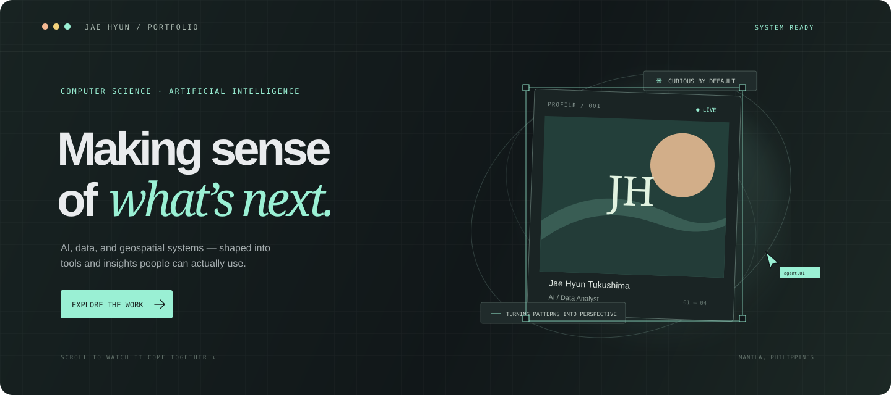

# Jae Hyun Tukushima · Portfolio

### A single-page experience composed as a sequence of moving scenes.

  
  
  
  

---

## Built as one continuous experience

The page is organized into full-screen scenes that lead into one another: an opening composition, featured work, background, journey, recognition, and a closing contact scene. A compact fixed navigation connects the major sections while the layout remains one uninterrupted scroll.

## Scroll choreography

GSAP ScrollTrigger pins each scene while its sequence plays. The page holds its composition as a simulated editor measures real DOM bounds, moves its selection frame between elements, and reveals them in their final positions. Once a scene is complete, it stays assembled when the visitor scrolls back.

The scroll position drives the sequence, so visitors can ease through it at their own pace. Reduced-motion preferences skip the build effects and show the completed layout directly.

## A small system of reusable parts

| Layer | Role |
| --- | --- |
| **Scene** | Provides a consistent full-screen frame, selection overlay, agent cursors, and progress indicator. |
| **Project rows** | Reuse a data-driven layout and measured selection animation for each featured build. |
| **Project disclosures** | Expand details inline, with accessible state and a scroll-layout refresh. |
| **Motion layer** | Coordinates pinned scroll sequences, real element bounds, persistent completed states, and reduced-motion behavior. |
| **Visual layer** | Combines Tailwind CSS utilities with a custom navy design system, responsive layouts, and fine-grained interaction styling. |

## Interaction details

- Section links move directly to Work, About, Journey, and Contact.
- Project details expand beneath their cards instead of interrupting the scroll with a new page.
- Buttons and cards use deliberate hover, focus, and press states.
- Layouts adapt for smaller screens, and keyboard focus remains visible.
- The build can be skipped for visitors who want to move straight through the page.

## Stack

**Next.js 16** · **React 19** · **TypeScript** · **Tailwind CSS 4** · **GSAP ScrollTrigger** · **Custom CSS**

*Measured, assembled, and set in motion.*

